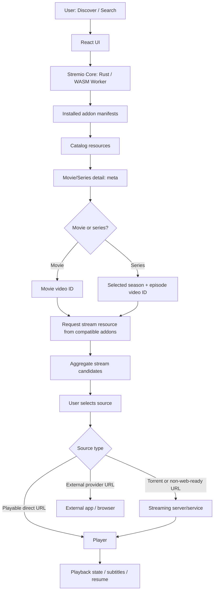
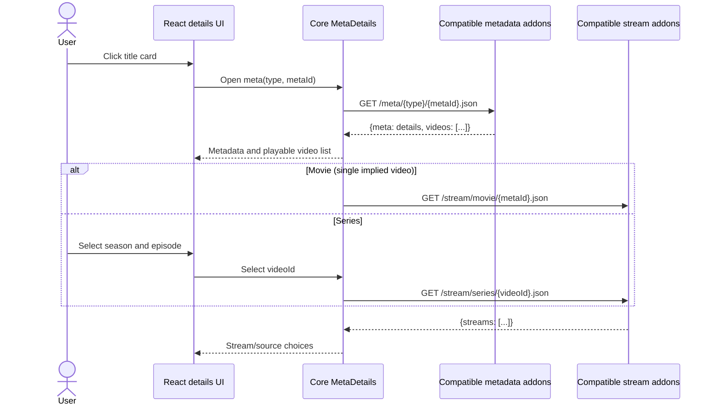
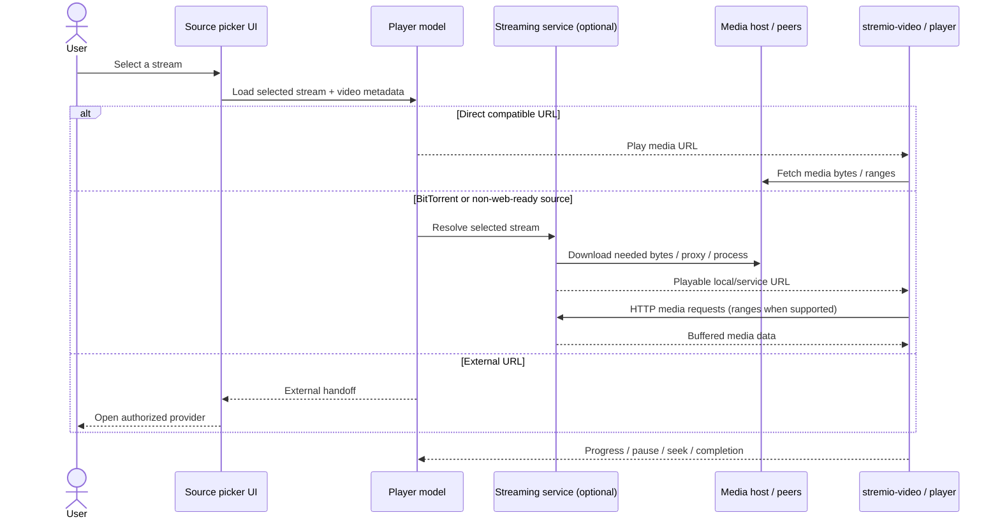

# Stremio Architecture — Engineering Research and Reimplementation Reference

> Research date: **20 November 2026**  
> Scope: Official Stremio web/core/addon ecosystem, media discovery, movie and series details, stream-source aggregation, torrent and HTTP streaming, playback, persistence, platform boundaries, and a practical rebuild blueprint.  
> Status legend: **[VERIFIED]** means supported by linked official project documentation; **[INFERRED]** means an engineering interpretation of documented mechanisms; **[PROPOSED]** means a suggested design for a new implementation, not a claim about Stremio internals.

## 0. Executive summary

Stremio is **not** a single video-hosting website or a centralized movie download server. It is an application platform that separates **content discovery and catalog metadata** from **stream-source discovery** and from **delivery/playback**. Its distinguishing capability is its **addon protocol**: an addon advertises capabilities via a manifest and provides JSON resources for catalogs, item details, streams, and subtitles. Multiple installed stream addons can return different candidate streams for the same movie or episode. The client aggregates those candidates and lets the user select one. The chosen stream can be a direct video URL, a BitTorrent info hash, an external provider link, a YouTube video, or other supported source type. [VERIFIED]

A modern web client uses **React** for UI, **stremio-core** (Rust compiled to WebAssembly in a Web Worker) for shared state and application logic, and **stremio-video** as an abstraction over playback implementations. A **separate streaming server/service**, used where the format or transport needs it, bridges formats such as BitTorrent into a player-consumable stream. The official project exposes streaming-server ports **11470** and **12470** in its Docker deployment example. [VERIFIED]

**Important terminology:** The list of items a user sees after selecting a movie or episode is a **stream/source list**, not necessarily a list of actual media storage servers. The `stream` JSON can represent multiple independent stream options from multiple addons. **Downloading a torrent while buffering playback** is different from an **explicit offline download saved in a user's library**. An addon can also point to legitimate external streaming providers without handling media bytes itself.

### The critical data path



**Evidence:** Core and web architecture: https://github.com/Stremio/stremio-core and https://github.com/Stremio/stremio-web ; resource relationship: https://github.com/Stremio/stremio-addon-sdk/blob/master/docs/api/README.md ; stream types: https://stremio.github.io/stremio-addon-sdk/api/responses/stream.html

---

## 1. Repository and component map

| Repository | Role | What to examine when rebuilding |
|---|---|---|
| [`Stremio/stremio-web`](https://github.com/Stremio/stremio-web) | Official React web interface | Catalog UI, details/episode UI, stream choice UI, player screen, core bridge |
| [`Stremio/stremio-core`](https://github.com/Stremio/stremio-core) | Shared Rust types, models, addon integration, runtime, user state | State machines, resource requests, `MetaDetails`, `Player`, `StreamingServer`, deep links |
| [`Stremio/stremio-addon-sdk`](https://github.com/Stremio/stremio-addon-sdk) | Node.js addon implementation SDK and protocol documentation | Manifest, resource contracts, SDK handlers and examples |
| [`Stremio/stremio-addon-guide`](https://github.com/Stremio/stremio-addon-guide) | Developer tutorials and resource explanation | End-to-end addon tutorial and content identifiers |
| [`Stremio/stremio-video`](https://github.com/Stremio/stremio-video) | Abstraction above platform media players | Player selection/controls and platform-specific playback |
| [`Stremio/stremio-shell`](https://github.com/Stremio/stremio-shell) | Desktop Qt shell | Native desktop environment and local server integration |
| [`Stremio/stremio-service`](https://github.com/Stremio/stremio-service) | Standalone streaming service packaging | Service installation and lifecycle |
| [`Stremio/server-docker`](https://github.com/Stremio/server-docker) | Official streaming-server Docker packaging | Ports, binary/FFmpeg integration and deployment |
| [`Stremio/stremio-addon-client`](https://github.com/Stremio/stremio-addon-client) | Addon-transport client | Compatibility and request transport concepts |

**[VERIFIED]** The core README lists `src/types`, `src/models`, `src/runtime`, `src/addon_transport`, `src/deep_links`, `stremio-core-web`, and ancillary Rust crates. The web README says the UI is a React app whose state and logic come from Rust/WASM in a Web Worker. **Do not assume that every desktop, mobile, TV and web distribution uses an identical player, download implementation, or UI route.**

### 1.1 Responsibility boundaries

- **UI layer:** Presentation, navigation, interaction, source selection, season switching, player controls and user-visible errors.
- **Core/model layer:** Application state, registered addons, discovery resources, metadata, stream choices, player state, library, watch history and deep links.
- **Addon transport:** HTTP/JSON calls to independent addon endpoints according to their declared capabilities.
- **Addon backend:** Search or lookup of metadata and stream records in the addon's own systems. The addon **usually returns a pointer to media** rather than sending the media file in its `stream` JSON response.
- **Streaming runtime:** Turns transport-specific data into playback bytes where necessary, including torrent fetching/buffering, stream proxying or media processing. Exact implementation varies by runtime and release.
- **Player:** Video decoder/rendering, controls, seek, audio/subtitle track selection, playback telemetry.
- **Account/sync services:** User account and state synchronization, as distinct from addon hosts and media hosts. Server-side implementation and private API details are not fully public.

### 1.2 Core state-management pattern [VERIFIED]

The documented Rust architecture follows an **Elm-style unidirectional data flow**:

```text
UI dispatches Action
  -> Runtime sends Msg to models
  -> Model updates state and emits Effects
  -> Env runs effects (fetch, storage, tasks, time)
  -> Effects report Internal messages
  -> Runtime emits NewState / CoreEvent to UI
```

The platform implements its `Env` abstraction; models include `Ctx`, `CatalogWithFilters`, `MetaDetails`, `Player`, `LibraryWithFilters`, `StreamingServer`, and `Calendar`. This matters: a React-only rewrite should preserve predictable async state transitions rather than burying network behavior inside visual components.

Source: https://github.com/Stremio/stremio-core#-architecture

---

## 2. The addon protocol: how everything connects

### 2.1 Manifest discovery and installation [VERIFIED]

Each HTTP addon serves a `manifest.json`, normally at:

```http
GET https://addon.example.org/manifest.json
```

A conceptual manifest (illustrative values, **not an installed public addon**):

```json
{
  "id": "org.example.licensed-streams",
  "version": "1.0.0",
  "name": "Example Licensed Media",
  "description": "Metadata and licensed stream links",
  "types": ["movie", "series"],
  "resources": [
    "catalog",
    { "name": "meta", "types": ["movie", "series"] },
    { "name": "stream", "types": ["movie", "series"], "idPrefixes": ["tt"] },
    "subtitles"
  ],
  "catalogs": [
    {"type": "movie", "id": "featured", "extra": [{"name": "search", "isRequired": false}]}
  ]
}
```

The client reads the manifest to know **what resources the addon supports**, **what content types** it handles, **which ID prefixes** it accepts, and **which catalog capabilities** it exposes. Stremio does **not** execute the addon's server code locally; it contacts its HTTP endpoints. An addon can be written in any language, and static JSON can be enough for a simple addon. Modern HTTP addons must send suitable CORS response headers. Additional transports, including legacy and IPFS forms, exist in the documented protocol.

**Additional manifest attributes:** optional `idPrefixes`, addon-specific `resources` type restrictions, `catalogs[].extra` for `search`, `genre`, and `skip`, `behaviorHints.p2p`, `behaviorHints.adult`, `configurable`, `configurationRequired` and specialized EPG hints.

**Configuration caveat:** Configurable addons can send user-specific configuration as part of their configured URL. **Treat such URLs as secrets** when they embed API keys or provider credentials; do not log or share them.

Sources: https://stremio.github.io/stremio-addon-sdk/api/responses/manifest.html and https://stremio.github.io/stremio-addon-sdk/protocol.html

### 2.2 Resources and their purpose [VERIFIED]

| Resource | HTTP path pattern | Expected response | Where used |
|---|---|---|---|
| Manifest | `/manifest.json` | Manifest object | Addon discovery/capabilities |
| Catalog | `/catalog/{type}/{catalogId}.json` | `{ "metas": [...] }` | Home/Discover/Search |
| Metadata | `/meta/{type}/{metaId}.json` | `{ "meta": {...} }` | Movie/series details |
| Streams | `/stream/{type}/{videoId}.json` | `{ "streams": [...] }` | Movie/episode source picker |
| Subtitles | `/subtitles/{type}/{id}.json` plus supported extra arguments | `{ "subtitles": [...] }` | Subtitle selection |
| Addon catalog | Addon-specific `addon_catalog` resource | Addon manifest list | Discover other addons |
| Player event | `/player/{type}/{videoId}/{extraArgs}.json` | Event acknowledgement | Optional addon activity integration |
| Library event | `/library/{type}/{metaId}/{extraArgs}.json` | Event acknowledgement | Optional addon library integration |

The protocol uses **path-encoded extra arguments**; e.g. `/catalog/movie/featured/search=example&skip=100.json`. This is different from a typical REST endpoint with `?search=...`, so a compatible implementation must serialize the extra-args segment correctly.

Relevant addons are filtered by declared `types`, `idPrefixes`, and catalog extras. For a `series` video whose identifier starts `tt`, an addon advertising `stream` for `series` and the prefix `tt` is eligible for that request. An addon claiming only `movie` must not be queried for that series episode.

**Source:** https://stremio.github.io/stremio-addon-sdk/protocol.html ; https://github.com/Stremio/stremio-addon-sdk/blob/master/docs/api/README.md

### 2.3 Metadata versus streams versus actual bytes

Three different objects must never be conflated:

1. **Meta item** = one movie or series, with display properties (name, poster, description, backdrop, cast, links, etc.).
2. **Video** = a playable unit inside an item; a movie usually has one implied video, while a series has episode video records.
3. **Stream** = one candidate way of accessing a video; this may be a direct URL, a torrent, or an external-service handoff.

An addon with only a `stream` resource can enrich an item whose metadata came from another addon (commonly Cinemeta with IMDb-based IDs). This is exactly why many independently installed source addons can populate a single unified source picker.

**Important exception:** A `video.streams` array embedded directly in the metadata can suppress normal requests to other stream addons for that video. A rewrite should explicitly model this exclusive-stream behavior instead of assuming that every click always fans out to every addon.

Sources: https://stremio.github.io/stremio-addon-sdk/api/responses/meta.html and https://github.com/Stremio/stremio-addon-sdk/blob/master/docs/api/README.md

---

## 3. Discover, homepage, search and details pages

### 3.1 Homepage/Discover sequence [VERIFIED]

1. The client knows the user's installed addons and their manifests.
2. It selects catalog definitions that apply to the requested content type and requested extras.
3. For the home/board page, it fetches compatible catalog resources and renders **meta previews** (name, poster, ID, type, etc.).
4. For Discover, filters such as genre and pagination are represented as catalog extra arguments.
5. For Search, it requests catalogs that explicitly support the `search` extra, and renders the returned previews.
6. Clicking a preview opens the metadata details flow.

Catalog addons are not necessarily playback addons. Catalog visibility does **not** guarantee a playable source exists.

**Pagination:** The official SDK describes `skip`; the common documented standard page size is 100. Do not assume every independent addon implements the same pagination correctly; handle partial or empty pages.

### 3.2 Details page sequence [VERIFIED]



**Nuance:** The SDK explicitly states that for a movie with only one video, streams may be requested **as soon as the details page opens**. For a series, picking an episode ordinarily triggers the corresponding stream request. The exact moment the source picker appears is a platform/UI decision; the core principle is that the **video ID** identifies the stream request.

### 3.3 Metadata schema [VERIFIED]

Typical metadata fields: `id`, `type`, `name`, `poster`, `background`, `logo`, `description`, `releaseInfo`, `released`, `runtime`, `genres`, `cast`, `director`/`directors` (consult current schema), `links`, and `videos`. A `series` detail includes video entries with `id`, `title`, `season`, `episode`, `released`, `thumbnail`, `overview`, and optional other properties.

Example (fictional title and IDs, **illustration only**):

```json
{
  "meta": {
    "id": "tt1234567",
    "type": "series",
    "name": "Example Series",
    "poster": "https://images.example.org/series-poster.jpg",
    "background": "https://images.example.org/series-backdrop.jpg",
    "description": "A fictional series used to explain the architecture.",
    "videos": [
      {
        "id": "tt1234567:1:1",
        "title": "Episode One",
        "season": 1,
        "episode": 1,
        "released": "2026-01-01T00:00:00.000Z"
      },
      {
        "id": "tt1234567:1:2",
        "title": "Episode Two",
        "season": 1,
        "episode": 2
      }
    ]
  }
}
```

The standard **Cinemeta IMDb-style episode ID** format is `{imdbId}:{season}:{episode}`. That is a convention for that metadata system, **not a requirement for all custom addons**. Store a `videoId` independently from `metaId`; never calculate an ID from season/episode unless the metadata provider's contract explicitly guarantees it.

Source: https://stremio.github.io/stremio-addon-sdk/api/responses/meta.html and https://stremio.github.io/stremio-addon-guide/sdk-guide/step3

### 3.4 Recommended details UI for a rebuild [PROPOSED]

**Movie:** hero/backdrop, poster, title, year, runtime, genres, description, watch actions, trailer, available source count, add/remove library, resume state, recommendations where available. Load metadata first and allow independent source-list loading/error state.

**Series:** same shared hero + **season selector** + **episode list** with episode thumbnail, number, title, synopsis, air date, played/progress badge, and episode action. Selecting an episode changes the selected `videoId` and source candidates without changing the main `metaId`.

**Source picker:** label the addon/provider separately from the stream's display name; show exact known properties (resolution, codec, size, language, seed/peer count only if actually available from a trusted extension). Provide loading, no-source, provider-timeout, and unsupported-playback states. Avoid implying any stream is verified until probed/played.

---

## 4. How the stream/source list is populated

### 4.1 Multi-addon aggregation [VERIFIED mechanism; INFERRED presentation details]

A stream-selection operation is conceptually:

```text
SELECT VIDEO: {type: 'series', metaId: 'tt1234567', videoId: 'tt1234567:1:2'}
  |
  +-- Addon A manifest: stream + series + tt prefix -> eligible
  +-- Addon B manifest: stream + series + tt prefix -> eligible
  +-- Addon C manifest: stream + movie only       -> NOT eligible
  |
  +-- GET A/stream/series/tt1234567:1:2.json
  +-- GET B/stream/series/tt1234567:1:2.json
  |
  +-- A returns [source1, source2]
  +-- B returns [source3]
  |
  +-- Normalize with addon provenance
  +-- Render selectable [source1, source2, source3]
```

**[VERIFIED]** The protocol says each compatible installed addon can answer a `stream` request, and the client uses the returned streams. **[INFERRED]** The exact concurrent scheduling, order, source grouping, presentation, cancellation and error-handling policies may change among versions and devices. A rewrite should use concurrent requests with bounded timeouts, independently rendered provider status, and stable source identities.

### 4.2 Stream object: the crucial contract [VERIFIED]

A stream has a **transport locator**, plus optional labels and behavior hints. Supported documented locator variants include:

| Field | Interpretation | Backend behavior |
|---|---|---|
| `url` | Direct video HTTP(S), FTP(S), RTMP etc. (client capability dependent) | Play directly if supported; otherwise proxy/transcode as appropriate |
| `infoHash` | BitTorrent info hash | Streaming runtime resolves torrent metadata/peers, buffers selected file |
| `fileIdx` | Selected file index within a multi-file torrent/archive | Selects an episode/movie file; missing torrent index defaults to largest file |
| `ytId` | YouTube video identifier | Built-in YouTube-player path |
| `externalUrl` | Website/deep link to an external provider | Launch externally; not a direct media download |
| `nzbUrl` | NZB/Usenet source | Transport-specific runtime; may use `servers` NNTP connections |
| `rarUrls`, `zipUrls`, `7zipUrls`, `tgzUrls`, `tarUrls` | Lists of archive source objects | Runtime-dependent archive handling and limitations |
| `sources` | Torrent trackers/DHT hints | Additional peer discovery for `infoHash`; not an addon-server list |
| `name` | Human-readable label, often used for quality | Display |
| `title` / `description` | Display description (`description` preferred in current docs) | Display |
| `subtitles` | Per-stream subtitle records | Pass to subtitle UI |
| `behaviorHints.notWebReady` | URL not usable as a direct web-playable URL | Require service/player support |
| `behaviorHints.proxyHeaders` | Headers for proxying a URL | Server-side requests; not browser-only direct playback |
| `behaviorHints.bingeGroup` | Match streams across subsequent episodes | Helps choose corresponding next-episode source |
| `behaviorHints.filename`, `videoSize`, `videoHash` | Media identity hints | Useful for subtitles and identification |
| `behaviorHints.countryWhitelist` | Geo-availability hint | Display/eligibility check, not a guarantee |

**Note on the word `servers`:** In the official stream schema, the `servers` field specifically describes **NNTP servers for `nzbUrl`**. The visually displayed set of different streams is **not** a single array called `servers`. For HTTP/torrent, the provider/addon returns separate `stream` objects. `sources` on a torrent describes trackers or DHT discovery hints, not a set of HTTP download mirrors.

Source: https://stremio.github.io/stremio-addon-sdk/api/responses/stream.html

### 4.3 Example direct HTTP streams

```json
{
  "streams": [
    {
      "name": "Example HD",
      "description": "1080p · Licensed CDN",
      "url": "https://cdn.example.org/authorized/movie-1080.mp4",
      "behaviorHints": {
        "filename": "example-movie-1080.mp4",
        "videoSize": 1000000000
      }
    },
    {
      "name": "Example SD",
      "url": "https://cdn.example.org/authorized/movie-720.mp4"
    }
  ]
}
```

These domains are **illustrative and not real working media links**. Multiple streams could come from **one addon**; the installed addons can contribute additional candidates. **Do not assume all HTTP URLs are playable by an HTML5 player**: content type, CORS, HTTPS, authorization, codecs, range support, and browser/platform capabilities matter.

### 4.4 Example torrent stream

```json
{
  "streams": [
    {
      "name": "Example Torrent",
      "description": "Demo source (only for lawfully distributable content)",
      "infoHash": "0123456789abcdef0123456789abcdef01234567",
      "fileIdx": 0,
      "sources": ["tracker:udp://tracker.example.org:80"],
      "behaviorHints": { "bingeGroup": "example-addon-1080p" }
    }
  ]
}
```

The hash and tracker are **synthetic placeholders**. `infoHash` identifies the torrent, not the HTTP address of the video file. The runtime still needs the torrent's metadata and its pieces. Torrent selection is *not* an immediate completed-file download.

### 4.5 Handling partial provider failures [PROPOSED]

Use `Promise.allSettled`, per-addon timeout, cancellation, and independent status tracking so one slow or failing addon does not hide streams from others. Deduplicate only when two records refer to an **equivalent** underlying stream; do not collapse two independent sources merely because both say "1080p". Preserve addon attribution and stream payload for playback.

```ts
// Reference design, NOT copied from Stremio source code.
type SourceResult = {
  addonId: string;
  addonName: string;
  videoId: string;
  stream: Stream;
};

async function collectSources(addons: Addon[], type: string, videoId: string) {
  const eligible = addons.filter((a) => supports(a.manifest, 'stream', type, videoId));
  const results = await Promise.allSettled(
    eligible.map(async (addon) => ({
      addon,
      streams: await fetchStreamsWithTimeout(addon, type, videoId),
    })),
  );
  return {
    streams: results.flatMap((r) =>
      r.status === 'fulfilled'
        ? r.value.streams.map((stream) => ({
            addonId: r.value.addon.manifest.id,
            addonName: r.value.addon.manifest.name,
            videoId,
            stream,
          }))
        : [],
    ),
    errors: results.filter((r) => r.status === 'rejected'),
  };
}
```

Here `supports` and `fetchStreamsWithTimeout` are **project-specific functions to implement**, not official SDK exports. Consider adding limits on concurrent requests and never forward addon-provided headers/secrets into analytics.

---

## 5. Playback: from click to video bytes

### 5.1 Common playback sequence



The protocol locates the content; the player/runtime determines how to consume it. Do not assume that a `stream` addon **itself** streams the bytes. In the common case it only **discovers** a location or identifier.

### 5.2 Direct HTTP delivery [VERIFIED concept; platform handling varies]

- An addon returns a video URL.
- The client decides whether it can play the stream directly in the current environment.
- The media player issues HTTP requests to the content host (often with `Range` requests for seeking).
- Browser support varies with container/codec combinations and with HTTPS, cookies, CORS, and authentication.
- If a source has `notWebReady` or needs custom proxy headers, a compatible streaming server may be required.
- For signed CDN URLs, never cache beyond expiry; keep original source URL secure.

**HLS/DASH:** These are important modern streaming formats in a rebuilt player, but **do not assume every Stremio client supports every HLS/DASH/DRM variant**. Test browser/player/OS combinations separately. DRM-protected services generally require authorized provider integrations; a media URL alone will not reproduce their licensing pipeline.

### 5.3 Torrent-backed streaming: what "download" actually means

**[VERIFIED]** The addon schema returns `infoHash`, optionally `fileIdx`, with `sources` supplying extra tracker/DHT hints. **[INFERRED runtime mechanics]** A BitTorrent streaming runtime typically performs:

1. Start/attach a torrent session for the info hash.
2. Retrieve torrent metadata and identify files.
3. Select the specific file index; for a series torrent, this is crucial because a single torrent can contain multiple episodes.
4. Discover peers via trackers/DHT where supported and permissible.
5. Select and prioritize pieces needed near the playback cursor; keep a buffer ahead.
6. Expose a local/service HTTP endpoint for the selected file, optionally with byte-range support.
7. Return media bytes to the player as they are obtained and verified; keep downloading as necessary during playback.
8. On seek, reprioritize around the target position; on stop, apply cache/session retention policy.

**Do not portray these details as a line-by-line audit of the closed/packaged Stremio streaming runtime.** They are the conventional mechanics consistent with its documented torrent source contract and local-service architecture. The exact cache size, piece priorities, seeding settings, transport internals, endpoint security, and persistence differ by version and configuration and need verification against the specific deployed runtime.

**Security and privacy:** BitTorrent peers may observe a user's IP address. An official addon manifest can expose `behaviorHints.p2p` to warn users. Respect copyright and licensing, network restrictions, and user consent. Do not enable P2P silently.

### 5.4 Local streaming server and network boundaries

Official Stremio server Docker packaging exposes **11470** and **12470** and makes FFmpeg/FFprobe available inside the service. The desktop shell/service ecosystem includes a local streaming server integration. This supports the broad **UI/client ↔ streaming service ↔ source** design, but is **not proof that every request on every platform uses the same port or API path**.

For architectural planning, separate:

```text
Browser or desktop UI
    -> Addon JSON API (metadata and stream descriptors)
    -> Player engine
        -> Direct HTTPS media URL [when supported]
        OR
        -> Streaming service (localhost or trusted remote host)
             -> HTTP media host / BitTorrent peers / protocol adapter
             -> streamed media bytes
```

Port **11470** is conventionally associated with local streaming-server HTTP access. **12470** is exposed in the official server Docker configuration and is commonly associated with HTTPS-capable server access in deployment contexts. Treat protocol/TLS/host binding and access control as **deployment-specific** rather than blindly hardcoding assumptions.

**Avoid exposing a media service unrestricted to the internet.** Validate/allowlist target schemes and hosts; secure sensitive endpoints, block server-side request forgery (SSRF), avoid arbitrary local-file access, enforce authentication if remote, and ensure CORS/TLS origins are appropriate. A public media proxy is a substantial security liability.

Sources: https://github.com/Stremio/server-docker/blob/main/docker-compose.yml ; https://github.com/Stremio/stremio-shell ; https://github.com/Stremio/stremio-service

### 5.5 What about a download button or offline mode?

**A crucial distinction:** Stremio's addon protocol describes **how a stream is found**. It does not require a universal application-managed **offline download** feature with a folder picker, completed-file manifest and offline rights management. Streaming a torrent downloads pieces to a streaming cache but is not the same user workflow as permanently saving a movie or episode.

For a rebuild, design offline download explicitly rather than assuming it is provided by `/stream`:

```text
Selected licensed source
   -> Eligibility check (rights, platform, source supports persistence)
   -> Download job created
   -> Fetcher (HTTP ranges / authorized protocol)
   -> Temporary file and checksum/integrity metadata
   -> Atomic commit to user-selected storage
   -> Offline catalog item / progress / storage usage
   -> Pause/resume/cancel/retry/expiry cleanup
```

For protected subscription media, offline playback is provider-specific, frequently DRM-governed and not generally reproducible by downloading a public-looking manifest. Do not attempt to bypass access controls.

---

## 6. Series season/episode navigation in detail

### 6.1 Identity model (most common source of rewrite bugs)

| Concept | Example | Meaning |
|---|---|---|
| Content type | `series` | Informs addon routing |
| Meta ID | `tt1234567` | Identifies whole series |
| Season number | `1` | UI grouping; not sufficient for lookup |
| Episode number | `2` | UI grouping; not sufficient for lookup |
| Video ID | `tt1234567:1:2` | Concrete episode stream resource identity |
| Stream identity | Addon ID + selected stream locator | Specific delivery option |

For a series, **do not request `/stream/series/{metaId}.json` when the addon expects an episode's video ID**. Use the `id` on the selected metadata `videos[]` entry. For a movie, the implied video ID commonly equals its meta ID.

### 6.2 Recommended episode selection state [PROPOSED]

```ts
type EpisodeSelection = {
  metaId: string;
  type: 'series';
  season: number;
  episode: number;
  videoId: string;
};

type SourcePickerState = {
  selection: EpisodeSelection | { metaId: string; type: 'movie'; videoId: string };
  status: 'idle' | 'loading' | 'partial' | 'success' | 'empty' | 'error';
  sources: NormalizedStream[];
  addonErrors: Record<string, string>;
};
```

When the user switches episodes while results for the previous episode are in flight:

- Abort old network requests where possible.
- Tie every result to the specific `videoId` that initiated it.
- Ignore stale results for an unselected episode.
- Cache recently requested episodes separately by `type + videoId + addon configuration/version`.
- Keep expanded-season state separate from the selected episode.
- Preserve progress per-video instead of a single progress number for the whole show.
- Display episode availability as a property of the chosen video, not as a guarantee that every source addon has it.

### 6.3 Continue watching and next-episode flow

`behaviorHints.bingeGroup` can help select a corresponding source automatically on a following episode. A robust implementation should:

1. Track `metaId`, `videoId`, selected stream, position and duration.
2. On near-completion, derive the next episode from the ordered metadata video list.
3. Respect metadata sequencing, specials and episode air dates, including nonstandard numbering.
4. Prefer a new stream matching the prior source's `bingeGroup` when valid; otherwise show source picker.
5. Avoid carrying forward a stale `fileIdx` unless the newly selected stream explicitly uses it.
6. Mark watched only after the product-defined threshold, with explicit replay/reset options.

The **bingeGroup hint** is documented; the exact automated next-episode UI and thresholds are product-level choices, not guaranteed by the protocol.

---

## 7. Subtitles, tracks and playback state

### 7.1 Subtitles [VERIFIED]

Subtitle addons provide a `subtitles` resource; streams can also include `subtitles`. Subtitle matching can use `videoId`, file hash, file size and filename hints, depending on the actual request and available metadata. Not every stream supplies all hints; a client without local server access may rely on provided `videoHash` and `videoSize`. The selected subtitles ultimately must be in a format supported by the platform's player or converted by an authorized processing layer.

Typical design:

```text
Video/stream selected
    -> Collect stream-bundled subtitles
    -> Query compatible subtitle addons using supported identifiers/extra args
    -> Merge by language/source/format/identity
    -> User chooses subtitle track
    -> Player loads or switches track
```

### 7.2 Playback events [VERIFIED]

The addon protocol includes optional **event** resources:

- `/player/{type}/{videoId}/action=start&currentTime={ms}&duration={ms}.json`
- `/player/{type}/{videoId}/action=pause&currentTime={ms}&duration={ms}.json`
- `/player/{type}/{videoId}/action=stop&currentTime={ms}&duration={ms}.json`
- `/library/{type}/{metaId}/action=libraryAdd.json`
- `/library/{type}/{metaId}/action=libraryRemove.json`
- `/library/{type}/{metaId}/action=watched...json`

These events can be sent to eligible installed addons; **their responses are not content-data responses**. User activity is sensitive, and addons that opt into these resources receive activity-related information. Do not silently forward watch history to untrusted services.

**Time units:** Current documented player event examples use **milliseconds**. Within a new app, normalize internal media-element seconds vs protocol milliseconds at one deliberate adapter boundary.

Source: https://stremio.github.io/stremio-addon-sdk/protocol.html

### 7.3 State synchronization

The official web README advertises synchronized library and Continue Watching across devices. It does not make the complete private sync backend architecture publicly available. For your own app, distinguish:

- **Ephemeral player state:** buffering status, selected subtitle, speed, current decode state.
- **Local durable state:** last selection and playback position for fast recovery.
- **Account-synced state:** library, watched flags, continue-watching position, preferences where permitted.
- **Addon event state:** optional third-party tracking integrations; not a substitute for authoritative user-state storage.

For cross-device synchronization, design conflict policies: server timestamp and device timestamp; newest progress vs furthest progress; explicit replay resets; offline queue; and eventual consistency.

---

## 8. The web application and UI architecture

### 8.1 Web implementation [VERIFIED]

Official `stremio-web` is React. `stremio-core-web` bridges a Rust/WASM core running in a Web Worker. `stremio-video` abstracts playback implementations. The core owns much of the state and request processing, rather than individual React components implementing every addon rule themselves.

```text
React routes, components, styles
         |
         v
Core binding / messages
         |
         v
Web Worker: Rust/WASM stremio-core
    |        |          |
    |        |          +--> Account/library/state services
    |        +-------------> Addon JSON resources
    +----------------------> State changes and player resolution
         |
         v
stremio-video / platform media player
         |
         v
Direct media or streaming service
```

Develop from the official repositories rather than scraping the live site for behavior, because service/browser/device details may differ between deployments.

### 8.2 Rebuild architecture recommendation: React + TypeScript [PROPOSED]

You do **not** have to rewrite Stremio's Rust core. You can implement a protocol-compatible client in TypeScript if your goal is a distinctly styled streaming application. Suggested boundaries:

```text
src/
  app/
    routes/                    # home, discover, search, details, player, addons, settings
    providers/                 # query client, session, theme, locale
  domain/
    catalog/                   # catalog and preview domain types
    metadata/                  # meta, video, season and episode domain types
    streams/                   # normalized stream, source scoring, source picker
    addons/                    # installed addons, manifests, capability matching
    playback/                  # player lifecycle and watch position
    downloads/                 # OPTIONAL explicit offline jobs, separate from streaming
    subtitles/                 # subtitle discovery and selection
    library/                   # local and synchronized user state
  infrastructure/
    addon-protocol/            # transport, URL encoding, parsing, validation, CORS
    media/                     # direct URL / streaming service / external provider adapters
    persistence/               # indexedDB / storage / API
    telemetry/                 # redacted diagnostics
  features/
    home/
    discover/
    detail/
    episode-list/
    source-picker/
    player/
    addon-manager/
  components/
    ui/                        # accessible shared design-system primitives
    media/                     # posters, hero, rail, chips, time-progress
```

For a React + shadcn/ui implementation: keep generic shadcn primitives and your reusable table/card/dialog components as presentation concerns. **Place addon compatibility, stream resolution and player routing outside UI components.** A horizontal movie rail should be usable with mouse wheel/trackpad/touch and keyboard while retaining proper focus and overflow affordances.

### 8.3 Data-fetching boundaries [PROPOSED]

Useful cache keys:

```ts
const mediaKeys = {
  manifest: (addonUrl: string) => ['addon-manifest', addonUrl],
  catalog: (addonId: string, type: string, catalogId: string, extras: object) =>
    ['catalog', addonId, type, catalogId, extras],
  meta: (type: string, metaId: string, addonSetVersion: string) =>
    ['meta', type, metaId, addonSetVersion],
  streams: (type: string, videoId: string, addonSetVersion: string) =>
    ['streams', type, videoId, addonSetVersion],
  subtitles: (videoId: string, mediaFingerprint: string) =>
    ['subtitles', videoId, mediaFingerprint],
};
```

For streams, cache lifetimes should be conservative: provider URLs and tokens may expire, while metadata can often be cached longer. Stream data should be invalidated when addon configuration or installed addon set changes.

---

## 9. What is a "server" in Stremio? Five distinct meanings

This ambiguity is central to the requested research:

1. **Addon server** — Returns JSON catalog/meta/stream/subtitle descriptors. It may not host the video.
2. **Metadata provider server** — Returns information about the movie or series (for example Cinemeta); no claim that it serves the video.
3. **Media/CDN host** — Stores and transmits the actual HTTP media bytes for a given direct URL.
4. **Streaming server/service** — Local or trusted remote component that makes non-browser-playable sources usable by the player, e.g. torrent media via an HTTP bridge.
5. **Torrent peers/trackers/DHT nodes** — Distributed peers supply pieces; trackers and DHT help locate them. Not equivalent to HTTP media mirrors.

**Additional case:** The documented `stream.servers` field denotes **NNTP (Usenet) server connections** specifically. **An external `externalUrl` service** (e.g. a subscription platform) is yet another path that typically hands playback off to the provider itself.

### Source-list display is a logical union, not a server registry

When a user opens a movie and sees several watch/download options, the system has ordinarily:

- Identified the requested movie/episode via a canonical content/video ID.
- Asked eligible addons to provide stream descriptors for that ID.
- Combined the returned descriptors for display.
- Deferred choosing a specific media transport until the user selects a descriptor.

This separation lets the **same metadata page** work with many source providers and keeps source-provider logic separate from page-rendering logic.

---

## 10. Operational concerns and failure modes

### 10.1 Network and data issues

| Symptom | Likely cause | Recommended handling |
|---|---|---|
| Title visible but no sources | Catalog/meta addon works; no matching stream addon or no results | Show which providers were checked and empty/error states |
| Movies work; episodes do not | Incorrect episode `videoId`, unsupported `series` type or ID prefix | Inspect metadata `videos[].id` and manifest filters |
| Sources visible; playback fails | Dead URL, unsupported codec, CORS/HTTPS, proxy headers, expired token, service not connected | Report source-specific cause and fallback options |
| Torrent buffers forever | Unavailable peers, wrong file index, trackers blocked, service failure | Check info hash, selected file, peer availability and service status |
| Some addons do not respond | Timeout, network, CORS, addon rate limit | Show partial results with independent provider errors |
| External link does not play in-app | `externalUrl` is a provider handoff, not a direct playable file | Open authorized external application/browser |
| Progress incorrect | Mixed seconds/milliseconds or wrong `videoId` | Normalize units and persist per video |
| Episode switches show stale results | In-flight responses overwriting current selection | Abort/ignore results by request generation or video ID |
| Browser works on one platform only | Codec, DRM, HTTPS, mixed-content, player differences | Capability-check and use appropriate supported player |
| Subtitles missing | Missing video hash/size/filename or unavailable subtitle addon | Report match limitations and permit manual selection |

### 10.2 Security requirements [PROPOSED]

Treat addons as **untrusted external services** even if configured by users. Validate JSON schemas and limit payload sizes; encode path values correctly; restrict URL schemes; prohibit internal network access from any backend proxy; avoid arbitrary request/response headers unless explicitly allowed; isolate credentials; rate-limit calls; enforce request timeouts; cache carefully; sanitize UI text; do not execute addon-supplied code. User IP addresses can be visible to P2P participants. Treat streaming history and library contents as private user data.

### 10.3 Reliability and performance [PROPOSED]

- Lazy load details images and long season lists; use image placeholders and responsive poster sizes.
- Fetch separate addon resources concurrently but with reasonable limits.
- Track per-addon latency and errors without leaking access keys.
- Do not block all results on one provider.
- Keep user selection stable when late results arrive.
- Reuse catalog/meta caches, but revalidate short-lived stream URLs.
- Prefetch next-episode metadata where supported, not unauthorized media downloads.
- Handle video playback errors independently of source lookup errors.
- Do not make "download complete" claims while only a streaming buffer exists.

---

## 11. Interfaces to implement in a protocol-compatible rewrite [PROPOSED]

These TypeScript shapes are a **simplified application-facing subset**, not exhaustive copies of the official schemas. Preserve unknown safe fields when proxying extension metadata.

```ts
type MediaType = 'movie' | 'series' | 'channel' | 'tv' | string;

type AddonManifest = {
  id: string;
  name: string;
  version: string;
  types: MediaType[];
  resources: Array<string | {
    name: string;
    types?: MediaType[];
    idPrefixes?: string[];
  }>;
  idPrefixes?: string[];
  catalogs?: Array<{
    type: MediaType;
    id: string;
    name?: string;
    extra?: Array<{ name: string; isRequired?: boolean; options?: string[] }>;
  }>;
  behaviorHints?: { p2p?: boolean; adult?: boolean; epgProvider?: boolean };
};

type MediaVideo = {
  id: string;
  title: string;
  season?: number;
  episode?: number;
  released?: string;
  thumbnail?: string;
  overview?: string;
  streams?: MediaStream[];
};

type MediaMeta = {
  id: string;
  type: MediaType;
  name: string;
  poster?: string;
  background?: string;
  logo?: string;
  description?: string;
  releaseInfo?: string;
  videos?: MediaVideo[];
};

type MediaStream = {
  name?: string;
  title?: string;
  description?: string;
  url?: string;
  externalUrl?: string;
  ytId?: string;
  infoHash?: string;
  fileIdx?: number;
  sources?: string[];
  behaviorHints?: {
    notWebReady?: boolean;
    bingeGroup?: string;
    filename?: string;
    videoSize?: number;
    videoHash?: string;
    proxyHeaders?: { request?: Record<string, string>; response?: Record<string, string> };
    countryWhitelist?: string[];
  };
};

type NormalizedStream = {
  streamId: string;
  addonId: string;
  addonName: string;
  videoId: string;
  stream: MediaStream;
};
```

### 11.1 Core application services [PROPOSED]

```ts
interface AddonRegistry {
  install(manifestUrl: string): Promise<AddonManifest>;
  remove(addonId: string): Promise<void>;
  list(): Promise<Array<{ manifestUrl: string; manifest: AddonManifest }>>;
  supports(manifest: AddonManifest, resource: string, type: string, id: string): boolean;
}

interface MediaRepository {
  getCatalog(addonId: string, type: string, catalogId: string, extras?: object): Promise<MediaMeta[]>;
  getMeta(type: string, metaId: string): Promise<MediaMeta>;
  getStreams(type: string, videoId: string): Promise<NormalizedStream[]>;
}

interface PlaybackResolver {
  resolve(source: NormalizedStream): Promise<
    | { kind: 'direct'; url: string }
    | { kind: 'service'; url: string }
    | { kind: 'external'; url: string }
    | { kind: 'unsupported'; reason: string }
  >;
}
```

### 11.2 Domain normalization rules [PROPOSED]

- Treat identity as a tuple (`type`, `metaId`, `videoId`, `addonId`, `streamLocator`), not a poster title.
- Preserve source provenance and raw stream payload until player resolution.
- Parse only explicitly declared fields; guard unexpected/null values.
- Distinguish metadata **availability** from confirmed **playability**.
- Represent the absence of a stream as an empty array, not a broken parser.
- Make "external provider", "direct stream", and "requires service" visibly distinct.
- Never persist a short-lived signed source URL as the only record of the movie.

---

## 12. Product implementation roadmap [PROPOSED]

### Phase 1 — Metadata, navigation and UI

- Manifest registry with install/remove, validation and persisted configuration.
- Catalog queries, search, Discover, genre/skip extras.
- Shared movie and series detail templates; season/episode model.
- Responsive media rails with pointer, touch, wheel and keyboard controls.
- Skeleton/error/empty states and metadata deduplication.

### Phase 2 — Multiple-source discovery

- Filter addon manifests based on content type and video ID.
- Fetch and aggregate independent stream responses with timeouts.
- Source panel (addon attribution, quality description, transport indicator).
- Source selection and preservation across navigation.
- Handle `video.streams` exclusive override and external provider handoff.

### Phase 3 — Playback and state

- Play supported HTTPS media in browser and supported native players.
- Add a separately deployed streaming-service adapter if torrent/non-web-ready playback is a product requirement.
- Subtitle discovery and tracks, watched/resume state, playlist/next episode.
- Player telemetry, source failures and retry selection.

### Phase 4 — Download feature (if explicitly required)

- Clarify **streaming cache** vs **offline download** in UI and data model.
- Implement licensed/offline-capable download jobs and storage management.
- Support progress, pause/resume/cancel, checksums and cleanup.
- Test storage quotas, credentials, rights expiry and interrupted downloads.

### Phase 5 — Hardening

- Test malicious/malformed addon responses, SSRF/CORS and secret leakage.
- Accessibility audit, mobile UX and low-bandwidth behavior.
- E2E tests for movie, series, source switching, playback, and resume.
- Instrument source lookup vs playback metrics separately.

---

## 13. Acceptance test matrix for the rewrite [PROPOSED]

| Test | Expected behavior |
|---|---|
| Movie with one metadata addon and three stream addons | Unified movie detail; compatible source options from all responding addons |
| Series S02E03 | Query exact `videos[]` ID, not only the parent series ID |
| Source addon returns empty list | Page remains functional; show no sources from that addon |
| One source addon times out | Other addon sources still displayed |
| Source addon only advertises `movie` | It is not queried for `series` |
| Different addons return equal-quality labels | Distinct playable source choices remain separate |
| `video.streams` embedded in meta | Honor documented exclusivity; no unintended aggregation |
| Direct HTTPS MP4 supported by browser | Direct player URL, no unnecessary torrent service |
| `infoHash` with multi-episode torrent | Correct selected `fileIdx` is retained/used |
| `externalUrl` stream | Opens authorized provider instead of pretending to play as HTTP video |
| Signed URL expires | Refresh source lookup and explain failure |
| Episode changed while old lookup in flight | No stale source list leaks into new episode |
| Continue watching after reload | Correct video and saved timestamp restored |
| Missing subtitle media hash | Graceful fallback to available subtitle choices |
| Streaming service offline | Clear service-specific diagnostic; retain direct playable options |
| P2P-enabled addon installed | Explicit P2P/IP/privacy disclosure |
| User removes addon | Its results disappear; relevant caches are invalidated |

---

## 14. py-stremio download experience: library-first architecture [PROPOSED]

The web download screen is an alternate control surface for the existing py-stremio downloader, not a second download engine. The local media library is authoritative for what is managed and what is missing; Stremio-style addons provide candidate streams only after an item is selected for download.

### 14.1 Source of truth and boundaries

```text
Media folders + downloaded files
          │ scan / inventory sync
          ▼
Library catalog (managed titles, seasons, episode inventory, missing items)
          │ user starts a library operation
          ├── Update library (terminal option 2): scan + metadata refresh
          ├── Download only (terminal option 0): scan current library, skip metadata refresh
          └── Update & download (terminal option 1): refresh library + metadata, then download missing
                          │
                          ▼
                  DownloadService (shared CLI/API engine)
                          │ addon stream discovery → source selection → HTTP/HLS/RD transfer
                          ▼
                 media folder + durable download state
```

- The library catalog and filesystem inventory decide which titles/episodes exist and are missing. Addon catalogs or source listings must not silently add download work outside that managed library.
- Metadata describes the library item and expected episode set; a stream descriptor is a temporary candidate, not proof of availability or a permanent source record.
- Source choice remains automatic through the existing quality/fallback policy. The dashboard must not display invented providers, seed counts, sizes, or speeds, and must not imply that selecting a decorative source row affects the downloader.
- Successful media files and download state remain the completion record. A stream lookup or partial transfer is not a completed library item.

### 14.2 `/download` controls and job lifecycle [PROPOSED]

The page exposes the terminal's three useful operations:

| Dashboard action | CLI equivalent | Work |
|---|---|---|
| **Download only** | `py-stremio 0` | Scan available folders and download currently missing content, without a metadata refresh |
| **Update & download** | `py-stremio 1` / `py-stremio --download` | Ensure the library/configuration is fresh, then download missing content |
| **Update library** | `py-stremio 2` | Scan and refresh metadata, without downloading |

Starting an action submits a job to the API process. The API owns execution and publishes status/progress; the browser is a subscriber/view and may be closed or navigated away from without cancelling the job. The page should rehydrate active job status from `GET /api/jobs` and resume live progress subscription on return. Job history is persisted after completion; active-job recovery across an API-process restart requires durable job claiming/recovery and is a separate reliability concern.

The Download screen is organized around the library queue: missing managed items, completed items, the active title/episode, actual bytes/rate when supplied by the downloader, and explicit terminal-equivalent actions. Empty, queued, active, completed, and failed states should come from library/job/progress data rather than hard-coded examples. Download settings may alter shared downloader controls, but source selection should be added only when the backend can pass that selection into a real download request.

### 14.3 Implementation path

1. Keep `ScanService`, `MetadataService`, `DownloadService`, stream resolution, quality fallback, resume, and validation as the shared application services.
2. Let the API submit the same service operations used by CLI options 0/1/2. Do not put scanner or downloader logic in React.
3. Derive the queue from catalog/filesystem inventory and refresh that view after job progress/completion.
4. Stream real progress events to the browser; render unknown totals as indeterminate instead of manufacturing percentages or transfer estimates.
5. Record job start/finish/status and show recent failures; keep credentials and configured addon URLs out of public browser logs.

## 15. Research limitations and what still needs source-code verification

This is a **source-based architectural study**, not a claim that every current code path in every Stremio release has been read or independently executed. Official README and protocol specifications were checked; a full line-by-line clone and instrumented runtime inspection were **not** possible in this environment. In particular:

1. **Private backend:** Stremio account sync, some service APIs and deployment details are not fully described in public repositories.
2. **Packaged media runtime:** Exact torrent engine versions, internal priority algorithms, cache paths, peer limits, seeding defaults, and transcoding decisions should be checked against the target runtime binaries/source where available.
3. **Version-dependent UIs:** Web, desktop, Android, TV and other clients may differ in source grouping, rendering, watch state, support for codecs, subtitles, remote service addresses and direct downloads.
4. **Nonstandard addons:** Third-party addons may implement configuration, source labels and provider-side caching differently; third-party proprietary provider APIs are not part of the universal Stremio protocol.
5. **Proprietary integrations:** External subscription-service playback and DRM licensing cannot be inferred from a public `externalUrl` alone.
6. **Offline downloads:** No universal offline-download workflow was established by the cited addon protocol. A rewrite must define its own offline requirements and verify any relevant official client capability per platform.
7. **Exact URL formation for local service:** Specific streaming-server media endpoint syntax and query parameters need runtime-specific source inspection and tests; do not hardcode an example path from community reverse engineering as an official immutable contract.

A practical next pass with direct repository checkout would inspect the current revision of `stremio-core/src/models/{meta_details,player,streaming_server}` (actual paths may change), `stremio-core/src/types/resource/stream.rs`, the web detail and streams screens, and relevant service implementation/build artifacts; record commit SHAs for reproducibility.

---

## 15. Primary sources and further reading

**Official project architecture**

1. Stremio Core README — https://github.com/Stremio/stremio-core
2. Stremio Web README — https://github.com/Stremio/stremio-web
3. Stremio Core Rust API source (`Stream`) — https://stremio.github.io/stremio-core/src/stremio_core/types/resource/stream.rs.html
4. Stremio Video — https://github.com/Stremio/stremio-video
5. Stremio Shell — https://github.com/Stremio/stremio-shell
6. Stremio Service — https://github.com/Stremio/stremio-service
7. Official Server Docker — https://github.com/Stremio/server-docker/blob/main/docker-compose.yml

**Addon API / actual documented contracts**

8. Addon Protocol — https://stremio.github.io/stremio-addon-sdk/protocol.html
9. SDK architecture and resource guide — https://github.com/Stremio/stremio-addon-sdk
10. SDK resources mapping — https://github.com/Stremio/stremio-addon-sdk/blob/master/docs/api/README.md
11. Manifest format — https://stremio.github.io/stremio-addon-sdk/api/responses/manifest.html
12. Metadata / Video schema — https://stremio.github.io/stremio-addon-sdk/api/responses/meta.html
13. Stream schema — https://stremio.github.io/stremio-addon-sdk/api/responses/stream.html
14. Catalog request / pagination — https://stremio.github.io/stremio-addon-sdk/api/requests/defineCatalogHandler.html
15. Stream request handler — https://stremio.github.io/stremio-addon-sdk/api/requests/defineStreamHandler.html
16. Stremio Addon Guide basics — https://stremio.github.io/stremio-addon-guide/basics
17. Series video ID tutorial — https://stremio.github.io/stremio-addon-guide/sdk-guide/step3
18. Stream tutorial — https://stremio.github.io/stremio-addon-guide/sdk-guide/step4
19. Deep links — https://stremio.github.io/stremio-addon-sdk/deep-links.html
20. Native EPG — https://stremio.github.io/stremio-addon-sdk/epg.html

**Versioning note:** Most GitHub links above point to moving default branches rather than pinned commits. Capture commit SHAs when you start implementation and revalidate type fields and runtime behavior against that snapshot.

---

## 16. The shortest reliable architectural rules to give another AI

1. **Use the official Stremio addon protocol; never merge metadata endpoints with stream-byte delivery.**
2. **Discover content through catalogs, then load details through `meta`, then use a specific `videoId` to request `stream`.**
3. **Movies usually use the meta ID as their video ID; series episodes use metadata-provided episode IDs.**
4. **Call all eligible stream addons, filter by manifest `resources`/`types`/`idPrefixes`, and aggregate results with addon provenance.**
5. **A `stream` resource returns candidate descriptors—not downloaded video bytes and not necessarily a list of hosting servers.**
6. **Route direct-play URLs to a suitable player; torrent or non-web-ready URLs to a compatible streaming runtime; `externalUrl` to the external provider.**
7. **Keep source choice, playback progress, subtitles, and downloaded/offline files as separate domains.**
8. **Implement partial provider failure handling; do not allow a single broken addon to break the movie or episode page.**
9. **Respect `video.streams` exclusivity, `fileIdx`, `bingeGroup`, and security-sensitive proxy headers.**
10. **Do not claim a stream is downloadable offline, available, licensed, or playable unless checked for the particular source and environment.**
11. **Treat installed addons, URLs, embedded credentials and media peers as distinct trust boundaries.**
12. **Use official docs as contracts and verify runtime specifics on the exact targeted release before implementing platform-dependent behavior.**
